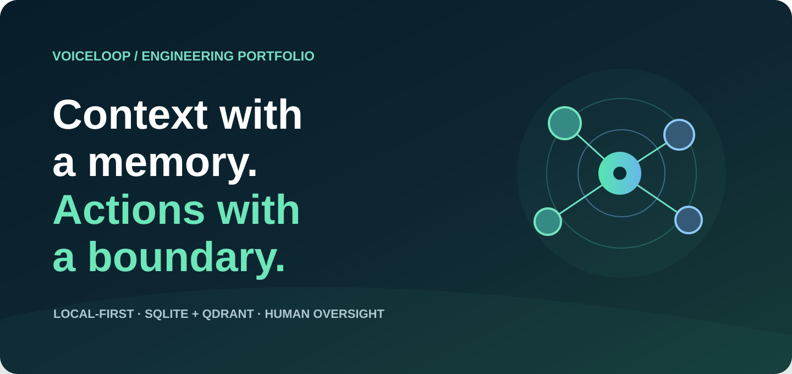
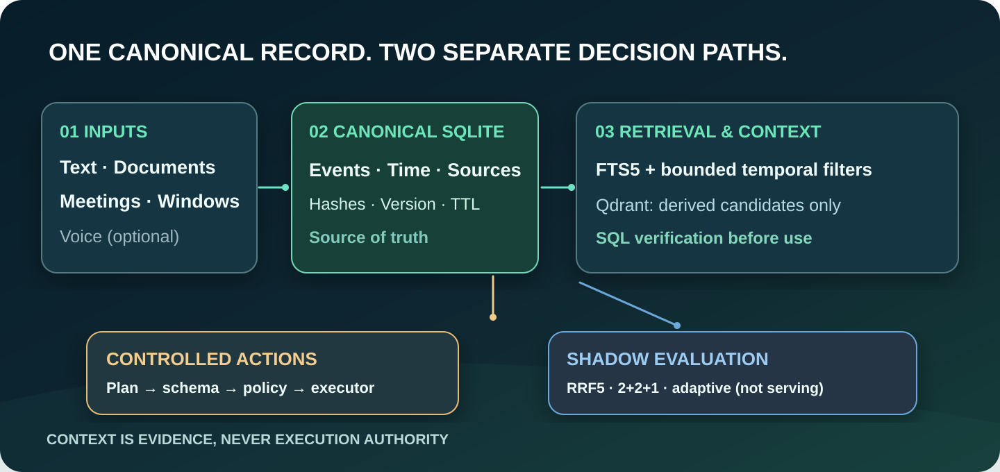
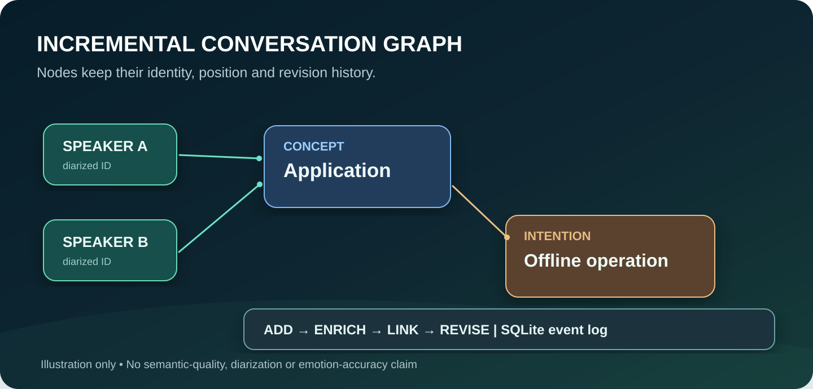
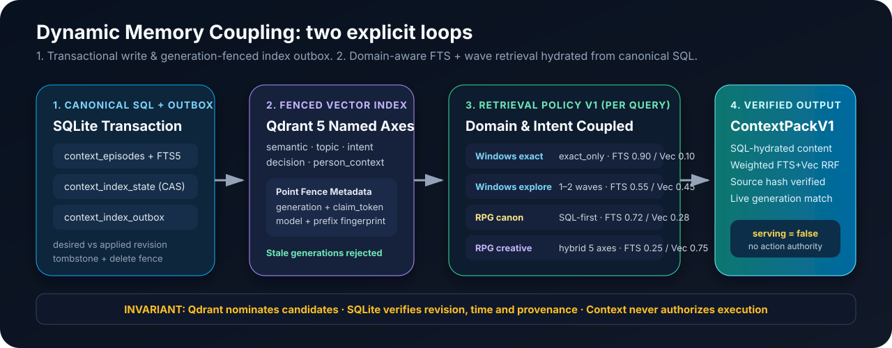
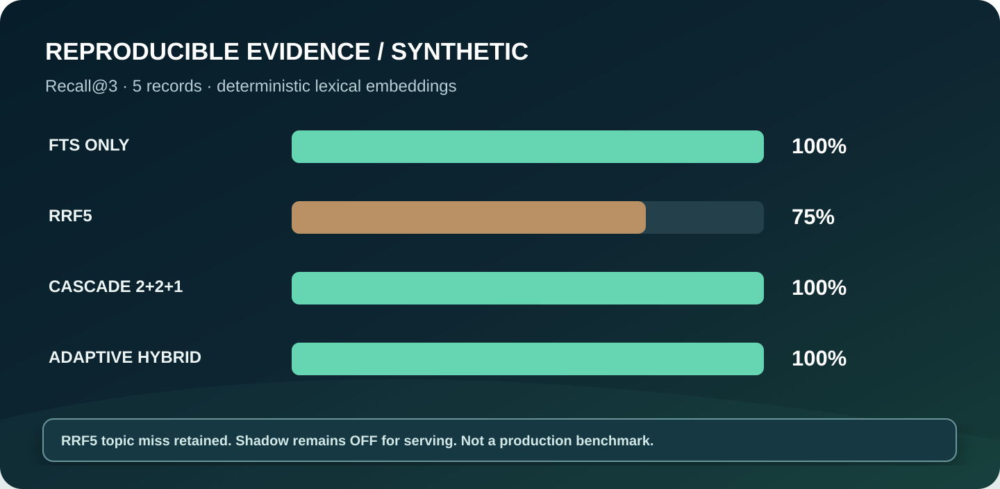

<div align="center">



# VoiceLoop
### Local-first context intelligence · Controlled AI actions · Auditable evaluation

**A Windows-first engineering project for remembering what happened, checking where it came from, and keeping AI proposals separate from permission to act.**

[**Explore the architecture**](docs/ARCHITECTURE_CURRENT.md) · [**See the case study**](docs/PORTFOLIO_CASE_STUDY.md) · [**Inspect the evidence**](docs/evaluation/context-evidence-v1/report.md) · [**Run locally**](#run-it-locally)

[](https://github.com/marcinromanowskilublin/VoiceLoop/actions/workflows/ci.yml)
[](LICENSE)
[](listener/pyproject.toml)
[](docs/CLAIMS_AND_EVIDENCE.md)

</div>

---

## Why this exists

A conversation mentions a decision. A document supplies a constraint. A Windows application contains the latest detail. Conventional assistants flatten these observations into text, often losing **time**, **provenance**, and the distinction between **a fact, a suggestion, and permission to act**.

VoiceLoop explores a different design: a canonical event record in SQLite, derived semantic candidate indexes in Qdrant, bounded retrieval, and an independent local action policy.

**The governing rule: context can inform an answer; it cannot authorize an action.**

## Explore the system



**01 · Observe.** Explicit adapters handle text, optional voice, documents, meetings, and Windows context. Integrations are opt-in where documented.

**02 · Ground.** SQLite owns time, source identity, lifecycle and content. Qdrant ranks candidates; SQL validates current source versions and bounds.

**03 · Decide safely.** The LLM proposes a typed plan. The local registry checks targets, arguments, risk and confirmation; only the executor reports an effect.

**04 · Measure separately.** RRF5, 2+2+1 and adaptive retrieval can be compared in shadow mode, without automatically switching the live context path.

## Featured work

### Incremental conversation graph — *new in November 2026*



Every diarized utterance produces **add**, **enrich**, **link** or **revise** operations. The graph is reconstructed from an append-only SQLite event log. Existing nodes retain their IDs, positions and history; the entire graph is not redrawn on every sentence. Emotion is represented as optional edge metadata, not a validated psychological inference.

[**Read the graph implementation**](listener/voiceloop/conversation_graph.py) · [**Inspect its tests**](tests/test_conversation_graph.py) · [**Open the local graph view**](panel/graph.html)

> **Current limitation:** the concept extraction path uses heuristic text matching; stable graph updates do not establish deep semantic understanding, diarization accuracy, or emotion validity. The standalone graph view can be opened at `/graph` when the local server is running.

### Verified memory, not vector-only memory



The index coupling uses transactional desired/applied generations, an outbox, leases, fingerprint checks and deletion fences. Time-aware retrieval must verify the candidate against canonical SQL; a stale vector cannot be treated as current evidence.

[**Read the memory engineering notes**](docs/DYNAMIC_MEMORY_COUPLING_V1.md) · [**See retrieval integrity tests**](tests/test_context_retrieval_integrity.py)

### Evidence before marketing



The committed **five-record synthetic** fixture reproduces an offline SQLite and Qdrant-local integration contract. FTS-only and adaptive hybrid both reach Recall@3 = 1.00; RRF5 scores 0.75 and retains a known missed topic example. This is **not** a benchmark on real user data, a clinical evaluation or proof of production readiness.

[**Read the full report**](docs/evaluation/context-evidence-v1/report.md) · [**Reproduce the evidence**](docs/CONTEXT_EVIDENCE_RELEASE_V1.md) · [**See what is not proven**](docs/CLAIMS_AND_EVIDENCE.md)

## What is operational — and what is not

| Implemented core | Explicitly opt-in | Shadow / research only |
| :--- | :--- | :--- |
| FastAPI, local UI, token boundary | External voice/model services | Routing V2 live promotion |
| SQLite memory, events, episodes, FTS | Time-first timeline recall | Dual-track retrieval selection |
| Typed plans, registry, local risk policy | Document/project ingest & projections | Adaptive retrieval serving |
| STOP, executor, confirmation pathway | Qdrant and Screenpipe adapters | Commitment analysis as authority |
| Persistent incremental graph API | Optional desktop automations | Situation State as action source |

Implementation and automated regression coverage are **not** proof of a live microphone, private retrieval quality, target Windows latency, or production deployment. Runtime flags and local `.env` may change enabled behavior. See the [detailed active/shadow/planned inventory](docs/ARCHITECTURE_CURRENT.md).

## Run it locally

**Platform:** Windows · **Python:** 3.11

```powershell
.\scripts\start-core.bat
```

Open **http://127.0.0.1:8765/** for the local panel or **http://127.0.0.1:8765/graph** for the graph view. The optional provider configuration lives in `listener/.env.example`; `listener/.env` is not required for the local-first defaults.

Run regression checks from `listener/` (after installing the pinned dev dependencies):

```powershell
.\.venv\Scripts\python.exe -m ruff check voiceloop ..\tests ..\vectorscope ..\scripts\run_context_evidence_demo.py
.\.venv\Scripts\python.exe -m pytest -c pyproject.toml -q
```

The CI workflow also runs a dependency audit and publishes a synthetic evidence artifact. [**CI workflow**](.github/workflows/ci.yml) · [**Full setup, optional tools & docs**](docs/README.md)

## Project, not clinical software

Created by **Marcin Romanowski**, psychiatrist and software builder. Clinical experience informs questions about ambiguity, consent, interruption and human oversight; it does **not** validate an AI system for medical use. VoiceLoop is **not a medical device** and does not claim diagnostic, therapeutic or crisis-response effectiveness.

**Read next:** [Portfolio case study](docs/PORTFOLIO_CASE_STUDY.md) · [Safety evaluation](docs/SAFETY_EVALUATION.md) · [Claims register](docs/CLAIMS_AND_EVIDENCE.md) · [Architecture](docs/ARCHITECTURE_CURRENT.md) · [Full documentation map](docs/README.md)

<sub>Portfolio presentation refreshed 2026-11-24 against the source revision `0b5900a`. Visual hero/overview/graph/evidence illustrations are explanatory graphics; they do not imply features or accuracy beyond the linked code and reports. Version remains 0.3.0 until a human-approved release.</sub>
