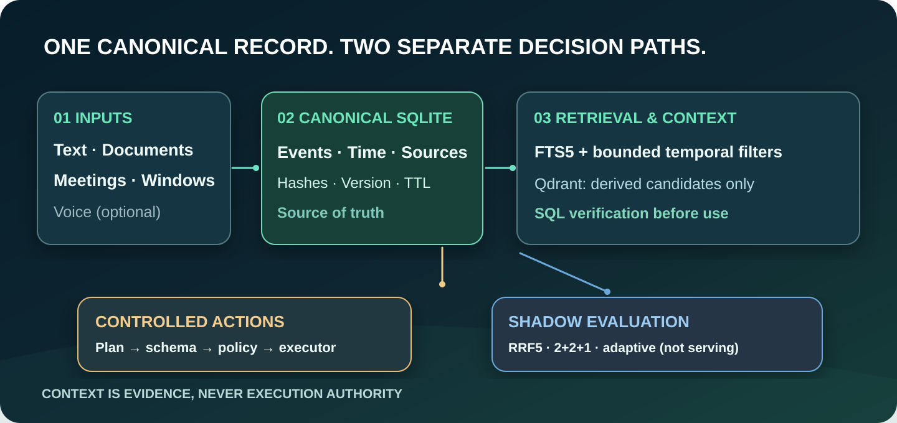

# Case study: proving a local-first context boundary


**Portfolio refresh (2026-11-24).** This study describes implemented engineering contracts and synthetic evidence, not a live deployment. The incremental November conversation graph has its own source and regression suite: [implementation](../listener/voiceloop/conversation_graph.py) · [tests](../tests/test_conversation_graph.py). For the shorter visual presentation, see [technical portfolio](PORTFOLIO_OVERVIEW.md).



## One-sentence summary

VoiceLoop explores whether documents, meetings, windows and local history can
be turned into bounded, source-aware evidence without letting retrieved context
silently become intent or authority.

## The problem

Work context is scattered across tools and usually loses three things when it
is copied into an AI workflow:

1. when the source observation actually happened;
2. where the claim came from and whether that source is still current;
3. whether the retrieved text is evidence, a proposal or an instruction.

The product hypothesis is that a useful context layer should sit beside
existing software, keep SQLite as the canonical record, use vectors only for
ranking, and preserve a separate local boundary for actions.

## What was built

- canonical timeline events and episodes in SQLite;
- transactional SQLite→Qdrant index state (`context_index_state` +
  `context_index_outbox`) with monotonic generations, lease/claim tokens,
  model-fingerprint verification and post-tombstone delete fences;
- named-vector search in a derived Qdrant index;
- SQL verification of source identity, content hashes, TTL, time range,
  applied generation and claim token;
- parallel RRF5 and bounded 2+2+1 retrieval in an isolated shadow collection;
- deterministic `RetrievalPolicyV1` and `AdaptiveHybridRetriever` that vary
  FTS/vector weights, axis coverage and wave budgets across `windows`, `rpg`
  and `general` profiles without weakening canonical SQL verification;
- a deterministic `agreement` / `conflict` / `uncertain` arbiter;
- expiring content-free traces;
- local action schemas that can raise risk and require confirmation;
- a read-only demonstrator and a reproducible public evidence command.

The dual-track and adaptive hybrid results do not enter the serving Context Pack
and cannot authorize an action.

## Reproduce the public evidence

Requirements: Python 3.11 and the locked project dependencies. No provider key,
network service, private transcript or microphone is used.

```powershell
cd listener
.\.venv\Scripts\python.exe ..\scripts\run_context_evidence_demo.py `
  --output ..\artifacts\context-evidence-demo
```

The command creates:

- `report.json` — machine-readable results;
- `report.md` — evaluation card and failure analysis;
- `report.html` — a standalone visual walkthrough.

It uses real SQLite and the local engine shipped by `qdrant-client`. Embeddings
are deterministic lexical hashes so the scenario is reproducible; they are
not presented as model-quality evidence.

Committed reference:
[`evaluation/context-evidence-v1/report.md`](evaluation/context-evidence-v1/report.md).
Every CI run regenerates the same scenario and uploads all three formats as the
`context-evidence-<sha>` artifact.

## Results and interpretation

The five-record fixture is deliberately small and synthetic:

| Track | Recall@3 | Positive-query MRR | Negative abstention | Smoke-run P95 |
|---|---:|---:|---:|---:|
| FTS only | 1.000 | 1.000 | 1.000 | regenerated per run |
| RRF5 | 0.750 | 0.500 | 1.000 | regenerated per run |
| Cascade 2+2+1 | 1.000 | 0.833 | 1.000 | regenerated per run |
| Adaptive hybrid | 1.000 | 1.000 | 1.000 | regenerated per run |

This is not a claim that the cascade or adaptive hybrid is universally better.
On this lexical fixture FTS is both faster and stronger, while RRF5 misses the
synthetic topic example. That failure is kept in the published report instead
of being hidden. The report also verifies transactional index coupling
(`consistent: true`) and deterministic domain policy profiles (`Windows exact`,
`Windows exploration`, `RPG canon`, `RPG creative` — all with
`serving_eligible: false`). The result supports the current product decision:
keep candidates in shadow and collect representative private labels before
discussing promotion.

The timing columns contain five smoke-run observations from the machine that
generated the artifact. They are useful for detecting gross regressions, not as
a benchmark or target-Windows estimate.

The same run also proves four observable safety outcomes:

- an agreement (same top canonical episode version) is recorded without
  changing serving context, even if lower-ranked results differ;
- a disjoint result becomes a conflict for review;
- an empty bounded range abstains;
- an unbounded request is rejected by the experiment.

Finally, a proposed `remember` action starts at low risk. The real
`CommandExecutor.submit()` path raises it locally to medium risk, persists
`awaiting_confirmation`, keeps it in the pending-confirmation map and leaves
the instrumented handler call count at zero.

## Verification and human decisions

Mechanical checks verify bounded contracts:

- Ruff verifies the declared code scope;
- dependency audit checks the pinned runtime lock;
- pytest covers retrieval integrity, index races, stale generations, policy
  boundaries and confirmation-only execution;
- the no-network evidence command executes real SQLite and local Qdrant
  integration and preserves known failures in its report;
- content-free trace assertions check that private query text and source IDs
  are not written to the published telemetry shape.

Some decisions deliberately remain outside automatic promotion:

- define the product problem and acceptable failure cost;
- approve axis meanings, private labels, retention and rollout criteria;
- decide whether a conflict is acceptable and whether any candidate can leave
  shadow;
- perform target-Windows observation and publish a release.

See [Safety evaluation and claim boundaries](SAFETY_EVALUATION.md) and
[Claims and evidence](CLAIMS_AND_EVIDENCE.md) for the evaluation hierarchy and
public wording rules.

## What remains unknown

- retrieval quality on representative private history;
- P50/P95 and resource use on the target Windows machine;
- longitudinal index drift and operator burden;
- whether the context view improves task outcomes for a real workflow;
- whether the current axis vocabulary matches users' mental models.

These are product and research questions, not missing numbers to invent.

## Release readiness

The evidence pack is release-ready when the branch is green and merged.
Publishing a version still requires a person to:

1. review the generated CI artifact and this interpretation;
2. choose the version number;
3. create the tag and GitHub Release;
4. attach or link the evidence artifact;
5. keep the private quality gate and target-machine results clearly separate
   from this synthetic reference.
