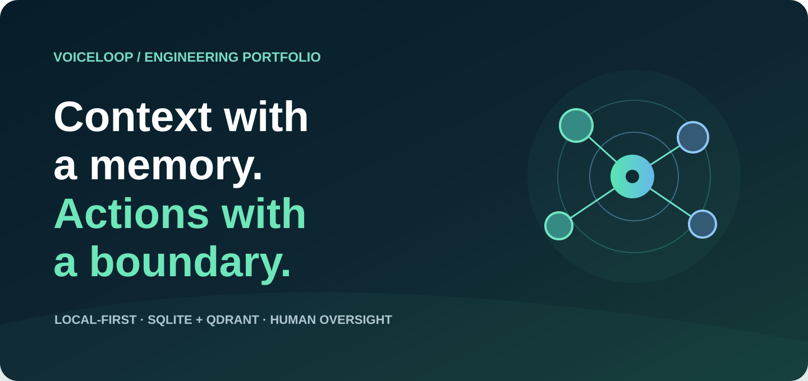
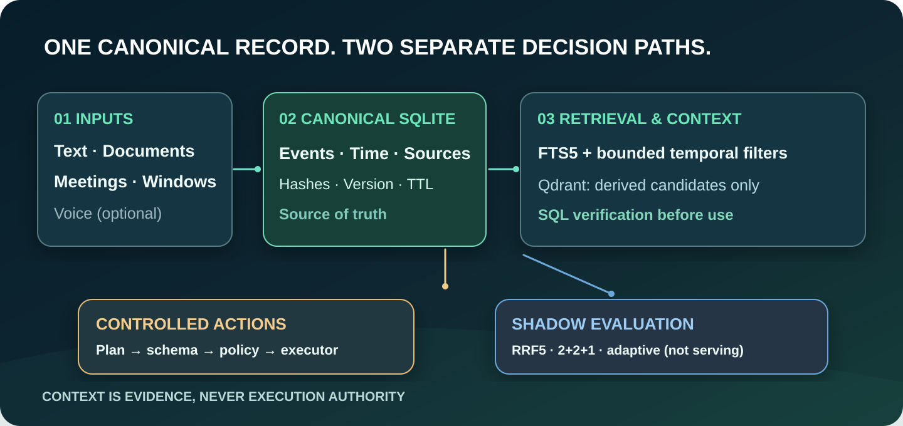
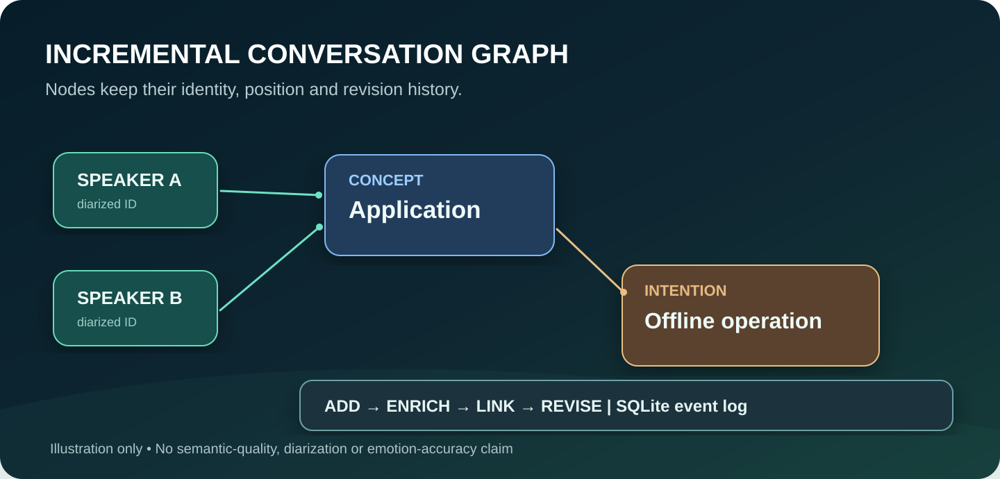
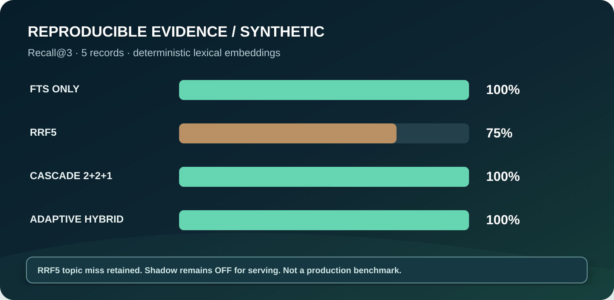

# VoiceLoop — technical portfolio at a glance

## The design challenge

Build a locally anchored AI context layer that can distinguish **what was observed**, **what is being requested**, and **what is actually permitted to happen**.

## Three engineering contributions

### 1. A time- and provenance-aware memory core
SQLite records the authoritative event, timestamp and source. Qdrant provides derived candidate ranking. An outbox and monotonic generations keep index updates observable. Time-first recall and adaptive vector strategies remain gated or shadow-only where specified.

### 2. An incremental conversation graph

Operations are **add / enrich / link / revise**, applied to an existing graph; IDs, positions and history persist. A deterministic heuristic can propose nodes, but a semantic-quality evaluation on real conversations is not established. Tests: [graph regression suite](../tests/test_conversation_graph.py).

### 3. Proof-oriented evaluation

The reported results are from a **synthetic five-record fixture**, with no private data and deterministic lexical hash embeddings. RRF5's topic miss remains visible. The evidence pack also checks a local action stops at confirmation without running its handler. [Full reproducible results](evaluation/context-evidence-v1/report.md).

## The security principle

> A model proposes. A local policy validates. An executor reports success.

Retrieved data never becomes executable intent by itself. This is an engineering architecture with bounded regression tests, **not** a claim of clinical safety, real-world reliability or full deployment validation.

## Read the implementation

[Source code](../listener/voiceloop/) · [Current architecture](ARCHITECTURE_CURRENT.md) · [Case study](PORTFOLIO_CASE_STUDY.md) · [Evidence and claims](CLAIMS_AND_EVIDENCE.md) · [Repository home](../README.md)

Portfolio status reviewed 2026-11-24. No release version change.
