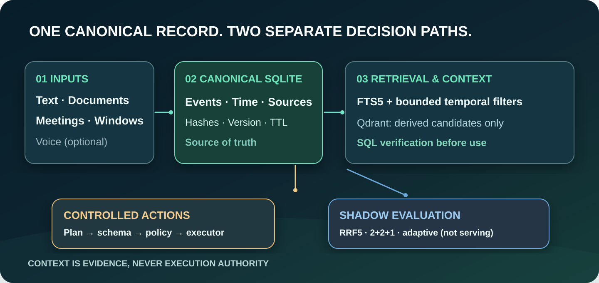
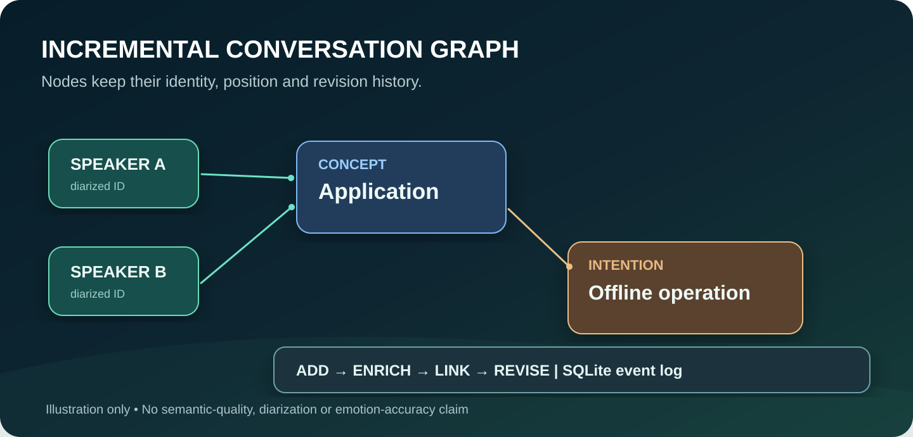
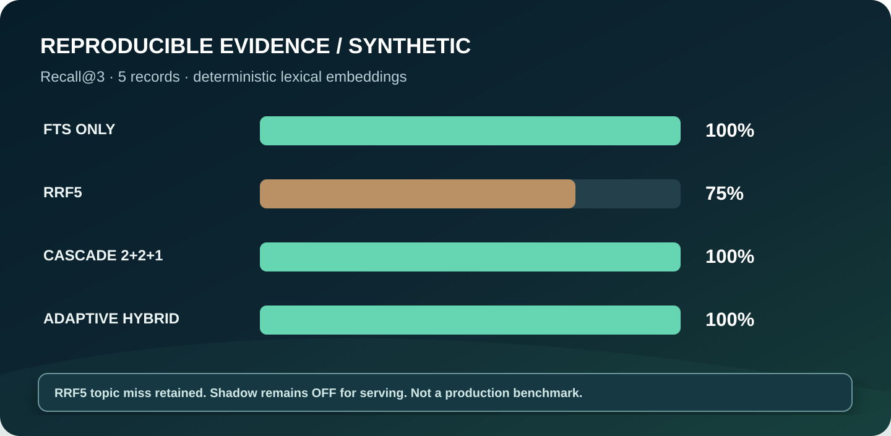

# Documentation · VoiceLoop

**An index for reading the system, not a second README.** The [portfolio home](../README.md) introduces the project; this page routes each question to the evidence or implementation that answers it. Source revision reviewed for the portfolio: `0b5900a` (2026-11-23). Public version: **0.3.0**, not a new release.

## Choose a reading path

### I want to understand the product in five minutes
- [Portfolio case study](PORTFOLIO_CASE_STUDY.md) — problem, engineering decisions, evaluation and limits.
- [Incremental conversation graph](../listener/voiceloop/conversation_graph.py) — current implementation of append/enrich/link/revise.
- [Graph view](../panel/graph.html) — interactive local front end (requires local running app).
- [Capability / adapter direction](img/voiceloop-capability-map-en-v1.png) — labeled future possibilities, not deployed capabilities.

### I want to review the architecture
- [Current architecture and November addendum](ARCHITECTURE_CURRENT.md) — source boundaries, active/opt-in/shadow status.
- [Architecture invariants](ARCHITECTURE_INVARIANTS.md) — enforceable limits of model authority.
- [Context Timeline](CONTEXT_TIMELINE_V1.md) — source time, provenance and retrieval.
- [Dynamic Memory Coupling](DYNAMIC_MEMORY_COUPLING_V1.md) — transactional index outbox and retrieval policy.
- [Memory-axis navigation](VECTOR_NAVIGATION_DESIGN.md) — a proposed direction, not a live feature.
- [Threshold Guard](THRESHOLD_GUARD.md) — threshold diagnostics and limits.

### I want reproducible evidence, not feature claims
- [Committed synthetic results](evaluation/context-evidence-v1/report.md) — five-record fixture and known RRF5 miss.
- [Evidence pack reproduction](CONTEXT_EVIDENCE_RELEASE_V1.md) — exact command and inputs.
- [Claims and evidence register](CLAIMS_AND_EVIDENCE.md) — implemented vs. tested vs. validated.
- [Safety evaluation](SAFETY_EVALUATION.md) — bounded engineering controls, proposed behavioral studies.
- [Safe user corpus](SAFE_USER_CORPUS.md) — private approval and holdout protocol.

### I want to inspect experimental boundaries
- [Dual-track prototype](DUAL_TRACK_CASCADE_PROTOTYPE.md) · [Cascade safety](KASKADA_BEZPIECZENSTWO.md)
- [Commitment Layer](COMMITMENT_LAYER.md) · [Evidence schema](EVIDENCE_V1.md)
- [Situation State](SITUATION_STATE_V1.md) · [State Proposal](STATE_PROPOSAL_V1.md)
- [Required human decisions](DO_WYKONANIA_PRZEZ_CZLOWIEKA.md)

## Visual library

More diagrams: [context workspace](img/voiceloop-context-workspace.svg) · [execution boundary](img/voiceloop-safe-execution.svg) · [dual-track](img/voiceloop-dual-track-flow.svg) · [time certainty](img/voiceloop-time-certainty.svg) · [arbiter](img/voiceloop-arbiter-outcomes.svg) · [memory architecture](img/voiceloop-memory-architecture.svg).

## Repository map

- `listener/voiceloop/` — source of runtime behavior
- `tests/` — regression checks and safety invariants
- `panel/` — localhost front end, including incremental graph view
- `vectorscope/` — read-only vector inspection and threshold experiments
- `scripts/` — explicit setup, evaluation and Windows utilities
- `voiceattack/`, `uivision/`, `n8n/` — optional external automation adapters
- `docs/archive/` — historical documentation; **not** the current contract

**Maintenance rule:** link to the canonical source, keep synthetic numbers identified, and do not turn shadow modules into deployed features by changing wording. No code paths or runtime flags are altered by this documentation refresh.
