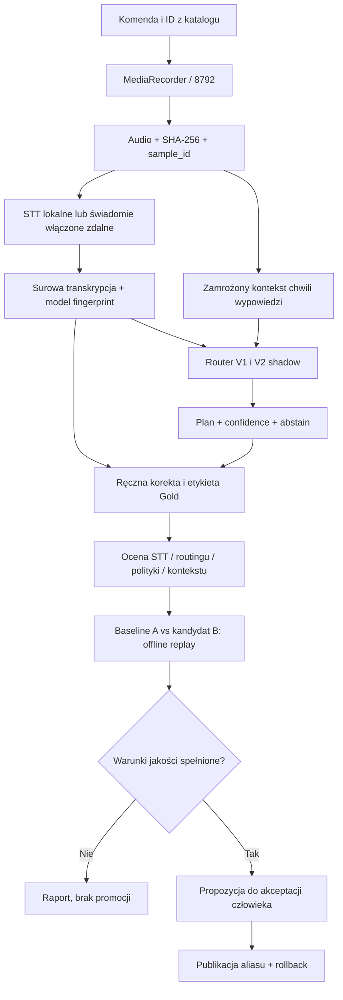

# VoiceLoop — Calibration & Context Evaluation V2 (projekt)

**Status:** SPECYFIKACJA, nie wdrożony system pomiarowy.  
**Przygotowano:** 2026-11-24 · gałąź `feature/minimalizuj-calibration-20261124`.  
**Założenie:** 30 krótkich poleceń Windows, 30 oddzielnych prób na polecenie, razem maksymalnie 900 prób przy pierwszym cyklu. Próby wykonane w jednej sesji NIE są 900 niezależnymi obserwacjami.

## 1. Inwentaryzacja prawdziwych mechanizmów VoiceLoop

Nie tworzyć drugiego silnika metryk. W repozytorium już znajdują się:

| Obszar | Źródło | Faktycznie mierzy | Brak w połączonym panelu |
| --- | --- | --- | --- |
| Audio/STT | `listener/voiceloop/corpus/voice_metrics.py` i `corpus/analysis.py` | WER, CER, interpunkcja, jakość etykiet; testowe replay Deepgram | Bezpośrednie powiązanie z seryjną próbką i jej korektą |
| Intencje i działania | `corpus/voice_metrics.py`, `corpus/analysis.py` | Exact plan accuracy, Top-K recall, MRR, safe abstention, unsafe resolution | Jedna oś „polecenie → plan → status wykonania” |
| Routing V2 | `routing/calibration.py`, `routing/service.py` | SQLite obserwacji i zatwierdzonych etykiet, score, margin, fingerprint, hash katalogu, tryb report-only | Integracja oznaczonych prób STT + ich kontekstu z istniejącym store'em |
| Opóźnienia | `conversation_telemetry.py` | STT, kontekst, model, tool, TTS; p50/p95, status 20+ próbek | Trwały link do sample_id i konkretnej decyzji |
| Kontekst | `context/evaluation.py` | Recall@K, MRR, nDCG, abstention, provenance | Badanie, czy kontekst poprawił rozróżnienie dwóch akcji |
| Diagnostyka progów | `threshold_measure.py` | Rozkłady i wykrywanie martwych lub nadmiernie szerokich progów | Progi jakości STT i routingu w panelu porównawczym |
| Zbieranie prób | `scripts/voice_capture_server.py` i `scripts/minimalizuj_studio.py` | Lokalny plik audio, licznik techniczny, manualna korekta w SQLite | Pełny katalog 30 kart, liczniki 30/30, powiązanie identyfikatorów |

**Uwaga:** obecny mechanizm `/minimalizuj` jest odrębnym studiem na porcie 8792; przechowuje korekty, ale nie jest odpowiednikiem produkcyjnego systemu ewaluacyjnego. `corpus/voice_metrics.py` ma własny, mocniejszy kontrakt anotacji i podziału development/holdout. Z niego należy korzystać zamiast równolegle definować „prawdziwy” WER.

## 2. Założenia produktu

1. **30 kart** z `scripts/command_catalog.py`: fraza, zamierzony `action_id`, opis działania, postęp 0/30, poprawność STT, poprawność routera i ewentualna konieczność potwierdzenia.
2. **Spacja rozpoczyna i zatrzymuje** jedną próbę. Po udanym zapisie pozostaje na tej samej komendzie i zwiększa licznik tylko po potwierdzeniu poprawnej próbki. Możliwość przejścia „Następna komenda”.
3. **Zapis w dwóch krokach:** najpierw niezmienny plik audio + SHA-256 + `sample_id`; potem obserwacje STT, wybrany plan, poprawka użytkownika. Brak STT ≠ błąd STT; brak anotacji ≠ wynik negatywny.
4. **Żadna komenda nie jest wykonywana podczas kalibracji.** Odpalanie rzeczywistej akcji jest osobnym, świadomie potwierdzanym trybem testowym; stan `queued` nie oznacza sukcesu Windows.
5. Korekta frazy **nie aktualizuje wag modelu STT**. Może zasugerować poprawkę mapowania i aliasu. Zmiana produkcyjnego routera jest osobną, odwracalną publikacją po replay i testach bezpieczeństwa.
6. **Kontekst to dowód pomocniczy, nigdy uprawnienie.** Sama zawartość okna i pamięć nie mogą nadać `action_id` bez wypowiedzi i decyzji polityki wykonania.

## 3. Przepływ danych — śledzenie jednej próby



Każda próba ma osobny `sample_id`. `command_id` oznacza **kanoniczną pozycję katalogu**; `request_id` oznacza próbę routingu/wykonania i nie powinien jej zastępować.

## 4. Minimalny kontrakt próbki (projekt `CalibrationSampleV2`)

```json
{
  "schema_version": 2,
  "sample_id": "uuid-v4",
  "command_catalog_id": "minimalizuj",
  "expected_action_id": "minimize_all_windows",
  "expected_phrase": "Minimalizuj",
  "audio": {"relative_path": "...", "sha256": "...", "duration_ms": 790},
  "capture": {
    "session_id": "uuid-v4",
    "captured_at_utc": "2026-11-24T12:00:00Z",
    "device_id_hash": "sha256",
    "environment": "quiet",
    "distance_band": "near",
    "speaker_role": "self",
    "mic_gain_bucket": "normal"
  },
  "stt": {
    "status": "transcribed",
    "provider": "local_or_approved_remote",
    "model_fingerprint": "sha256",
    "transcript_raw": "Minimalizuje",
    "confidence": null,
    "latency_ms": 320
  },
  "gold": {
    "transcript_verified": "Minimalizuj",
    "annotator": "owner",
    "confirmed_at": "2026-11-24T12:00:01Z",
    "split": "development"
  },
  "context_snapshot_id": "uuid-v4",
  "router": {
    "candidate_action_id": "minimize_all_windows",
    "router_fingerprint": "sha256",
    "alias_version": "v1",
    "score": null,
    "margin": null,
    "outcome": "proposed"
  },
  "execution": {"mode": "dry_run", "status": "not_executed"}
}
```

Pole `device_id_hash` i `context_snapshot_id` opisują lokalne, niedające się bezpośrednio upublicznić identyfikatory; powyższy JSON jest tylko przykładem schematu.

**Przechowywanie:** SQLite jako źródło prawdy, osobna tabela `calibration_samples`, `calibration_annotations`, `calibration_run_results`, `calibration_context_snapshots`, `calibration_change_proposals`; audio w katalogu `data/calibration-phrases`, z atomowym zapisem i niezmiennym hashem. Zamrożona anotacja Gold nie może być nadpisana w miejscu; korekta tworzy nową rewizję. Unikalny `sample_id`; duplikaty techniczne i ponowne próby mają `retry_of` i nie zwiększają licznika prawidłowych prób dwukrotnie. Osobne klucze po `command_catalog_id`, `session_id`, `run_id`.

## 5. Metryki: NIE mieszać różnych błędów

| Warstwa | Mierzyć | Interpretować |
| --- | --- | --- |
| Mikrofon / segmentacja | długość, RMS/peak, ucięty początek/koniec, no-speech | Problem wejścia, nie automatycznie problem modelu |
| STT | WER, CER, exact normalized phrase, no-speech, confidence calibration | Jakość transkrypcji wobec ręcznie zweryfikowanego tekstu |
| Routing | exact action + argumenty, Top-3, MRR, confusion matrix, margines, abstention | Czy dobry tekst prowadzi do właściwego planu? |
| Kontekst | wzrost/spadek exact action przy stałym audio, fałszywych aktywacjach i odsetku abstention | Czy kontekst *pomaga*, a nie tylko zwiększa pewność? |
| Bezpieczeństwo | unsafe resolution, wykonanie bez potwierdzenia, false activation per hour | Twarda blokada promocji przy regresji |
| Egzekucja | queued/awaiting_confirmation/succeeded/failed, latency p50/p95, real verified effect | Nie utożsamiać `queued` z faktyczną minimalizacją |
| Pokrycie | zapisane/zaakceptowane/anotowane/holdout na każdą komendę | `30/30` oznacza liczbę dobrych próbek, nie skuteczność 100% |

**Ważne:** przy jedno- lub dwuwyrazowych komendach WER może być skokowy (0%, 100% lub więcej). Na wykresach należy stawiać obok siebie *exact command recognition*, *exact action accuracy*, CER i odsetek abstention. Pojedynczy ogólny „score jakości” byłby mylący.

Podawać zawsze liczniki: `27/30` poprawnych, a nie samo „90%”. Przy małej próbie używać przedziałów Wilsona lub bootstrap po **sesjach**, nie po 900 zależnych fragmentach.

## 6. Uczciwe porównanie A/B (te same nagrania)

**Pierwszy eksperyment:**
- A = istniejący STT i istniejący router, bez dodatkowego kontekstu.
- B = **dokładnie ten sam** wynik STT i ten sam router z zatwierdzonymi aliasami.
- C = ten sam STT i router + dopuszczony, zamrożony kontekst chwili wypowiedzi.
- D = aliasy + kontekst; wynik porównać tylko pomocniczo, bo zmienia dwie zmienne naraz.

Dla jednej próbki wszystkie warianty korzystają z tego samego `audio_sha256`, `gold_label_sha256`, `context_snapshot_id` i zamrożonych fingerprintów systemu. Rejestr wersji: `dataset_sha256`, `annotations_sha256`, `splits_sha256`, `stt_model_fingerprint`, `router_fingerprint`, `alias_set_hash`, `context_policy_hash`.

**Sprawdzenie lokalizacji błędu:** uruchomić routing dwukrotnie: raz na **surowej transkrypcji STT**, drugi raz na **ręcznie zweryfikowanej transkrypcji**. Jeśli drugi przebieg naprawia intencję, problem leży przed routerem (w STT/normalizacji). Jeśli oba dają złą akcję, badać routing, argumenty i kontekst. Tego nie wolno nazywać „treningiem STT”.

**Split:** sugerowane 20 prób na komendę w development, 10 prób w zamrożonym holdout. Zbiór holdout zebrać w innych sesjach lub warunkach, nie jako losowe sąsiednie próbki z tego samego dnia. Przynajmniej jeden kontekst negatywny: zwykła rozmowa zawierająca słowo „otwórz”, niebędąca poleceniem. Nie dopuścić do przenoszenia powtórek tego samego nagrania między splitami.

**Kryteria proponowane (NIE obecne progi VoiceLoop):**
- Żadnych nowych niesankcjonowanych akcji ani wykonania bez potwierdzenia.
- Brak spadku jakości na holdout dla którejkolwiek kategorii wysokiego ryzyka.
- Wzrost lub brak regresji macro exact-action accuracy na zamrożonym holdout.
- Co najmniej 30 prób na komendę w finalnym zbiorze i realna kontrola jakości źródeł.
- Każda propozycja poprawki musi mieć identyfikatory próbek, model/konfigurację i rollback.
- Nie publikować bez danych; brak holdout = „insufficient evidence”, nie PASS.

## 7. Kontekst: mały, właściwy i sprawdzalny

Nie dopisywać „całej pamięci użytkownika” do każdego polecenia. Zamrażać **minimalny kontekst** w momencie startu i końca wypowiedzi, wraz z czasem i źródłem:

- **system:** aktywna aplikacja (np. Notatnik), kategoria okna, identyfikator urządzenia, tryb pracy; opcjonalnie aktywny plik/kursor **tylko jeśli potrzebne** do polecenia;
- **dialog:** ostatnia intencja i czy istnieje oczekujące potwierdzenie; TTL ≤ 30 s (propozycja);
- **polityka:** `voice_action_allowlist`, wyłączenia, ryzyko, tryb dry-run;
- **jakość audio:** SNR proxy/hałas, odległość jako przedział, device ID hash, poziom wejścia;
- **provenance:** `captured_at`, `expires_at`, `source_id`, `content_hash`, `context_policy_version`.

Przykłady:
- „Zwiń” + aktywne okno A → `minimize_active_window`. Nie potrzeba pamięci semantycznej.
- „Zamknij” + kursor na oknie A → **propozycja i potwierdzenie**, nigdy ciche `WM_CLOSE`.
- „Otwórz” bez obiektu → **clarify**, nawet jeśli w historii jest ostatnio otwierana strona.
- „Cofnij” → **clarify**: przywrócenie kursora, cofnięcie tekstu czy nawigacja? Kontekst ma zawężać pytanie, nie arbitralnie wybierać.
- Rozmowa „a gdybym powiedział otwórz Chrome?” → brak wykonania; potrzebny zestaw negatywny.

**Zakaz:** zapis surowej treści z okien pacjentów lub rozmów w korpusie kalibracyjnym. Domyślnie tylko kategoria aplikacji i sygnały techniczne; prywatne dane tylko po jawnym opt-in, z redakcją, retencją i możliwością usunięcia. Same odciski i metadane też są danymi do ochrony.

## 8. Ekran localhost: trzy poziomy widoku

**Nawigacja:** `http://127.0.0.1:8792/kalibracja`; dotychczasowe `/minimalizuj` pozostaje trwałym skrótem do karty 1.

**Widok A — Nagrywaj:** 30 kart, filtr kategorii, licznik dobrych/anotowanych prób na każdą, duża fraza, Spacja start/stop, odsłuch, anulowanie, od razu kolejne `1/30`…`30/30`.

**Widok B — Wyjaśnij:** audio, oczekiwany tekst, surowy STT, wersja poprawiona, różnica na poziomie słowa i znaku, wynik routingu A/B, przyczyna opisana jako **hipoteza**, propozycja aliasu, przycisk Zatwierdź/Odrzuć; porównanie po zatwierdzeniu w shadow.

**Widok C — Porównaj:** zakres dat, kohorta (session/device/noise/command), zestawy A/B/C, wspólne `run_id`; wykres p50/p95, macierz pomyłek, rozkład WER/CER, action accuracy po komendach, abstention, fałszywe aktywacje, safety gate, lista przykładów `regressed` i `fixed`. Klik w punkt otwiera zamrożony ślad i jego pochodzenie, nie modyfikuje oryginalnego grafu.

**Status próbki:** `recorded` → `transcribed` → `annotated` → `evaluated`. Osobne `failed`, `excluded`, `pending_review`. Poza tym zawsze widoczny stan dostawcy STT: offline / remote approved / unavailable.

## 9. API (propozycja, jeszcze niezaimplementowane)

- `GET /api/calibration/v2/catalog` — 30 komend + licznik poprawnych i anotowanych prób.
- `POST /api/calibration/v2/samples` — atomowe zapisanie próbki i metadanych; idempotency key.
- `POST /api/calibration/v2/samples/{sample_id}/annotate` — tworzy nową rewizję Gold.
- `GET /api/calibration/v2/samples/{sample_id}/trace` — łańcuch STT → routing → kontekst → status.
- `POST /api/calibration/v2/runs` — wyłącznie offline/shadow na zamrożonym zbiorze.
- `GET /api/calibration/v2/runs/{run_id}/compare` — wyniki A/B/C i karty regressions.
- `POST /api/calibration/v2/proposals/{id}/review` — approve/reject propozycji.
- `POST /api/calibration/v2/proposals/{id}/promote` — odrębna autoryzacja + quality gate + atomowy rollback.

Wymóg: pozostawić ruch w 127.0.0.1, ochrona Origin/Host, rozdzielić uprawnienia `capture/read`, `annotate`, `promote`; żadnej generalnej komendy na endpointach ewaluacji. Nie udostępniać tokenu core przez publiczne odpowiedzi studia.

## 10. Plan wdrożenia i testy PASS/FAIL

**Etap 1 — Spójne nagrywanie i postęp:** zasilić karty z `command_catalog.py`, jeden `sample_id` na jedno nagranie, licznik dobrych/zweryfikowanych 0/30 odczytywany z SQLite, sprawdzenie restartu. PASS: 30 odrębnych kart i wiarygodne liczniki, brak podwójnych zapisów.

**Etap 2 — STT + korekta:** użyć istniejącego `TranscriptEnvelopeV1` i `VoiceGoldAnnotationV1`; automatyczna transkrypcja tylko przez zatwierdzonego dostawcę i widoczny stan prywatności. PASS: trwale zapisane Gold oraz rozdzielenie no-speech od niedostępności STT.

**Etap 3 — Replay + parowanie:** łączenie z `corpus/voice_metrics.py`, `routing/calibration.py`, `conversation_telemetry.py`. PASS: ta sama próbka, dwa `run_id`, ten sam dataset hash; macierz „fixed/regressed/unchanged”.

**Etap 4 — Kontekst:** lekki snapshot z TTL i testy A/B/C. PASS: kontekst pomaga w poprawnym doborze lub prowadzi do abstention; nigdy nie zwiększa zakresu uprawnień.

**Etap 5 — Bezpieczna publikacja:** zatwierdzenie poprawki, replay na holdout, diff konfiguracji, rollback. PASS: zero akcji bez wymaganego potwierdzenia i brak regresji na zablokowanym holdout.

### Krytyczne testy negatywne

1. Dwa równoległe kliknięcia Spacji nie tworzą dwóch plików.
2. Nagrywanie „minimalizuj” w trybie kalibracji nigdy nie minimalizuje okien.
3. `recognized=""` jest `no_transcription`, nie „WER=100%”.
4. `queued` nie jest `succeeded`.
5. Cofnięcie aliasu nie zmienia oryginalnej próbki i nie usuwa audytu.
6. Usunięcie pliku audio oznacza próbkę jako `unavailable`, a nie `passing`.
7. Zmiana modelu STT wymaga nowego `run_id` i fingerprintu.
8. Context TTL przekroczony → brak arbitralnej akcji.
9. „Zamknij” bez jednoznacznego celu → pytanie, nie wykonanie.
10. Zero dostępnych danych → „brak pomiaru”, nigdy 0% ani 100% jako pewny wynik.

## 11. Najkrótszy spokojny krok dla Cursora

> Otwórz tę specyfikację i aktualne `scripts/command_catalog.py`, `scripts/calibration-phrases/minimalizuj.html`, `scripts/voice_capture_server.py`. **Zrealizuj wyłącznie Etap 1.** Nie dodawaj nowego silnika STT, routingu ani endpointów wykonawczych. Upewnij się, że 30 kart ma trwałe liczniki z SQLite, a Spacja nagrywa jedną próbę bez podwójnego zapisu. Dane w lokalnym `Pulpit\audio` traktuj jako prywatne; nie kopiuj ich do repozytorium i nie wykonuj operacji destrukcyjnych. Uruchom regresje i podaj PASS/FAIL wraz z linkiem lokalnym.
